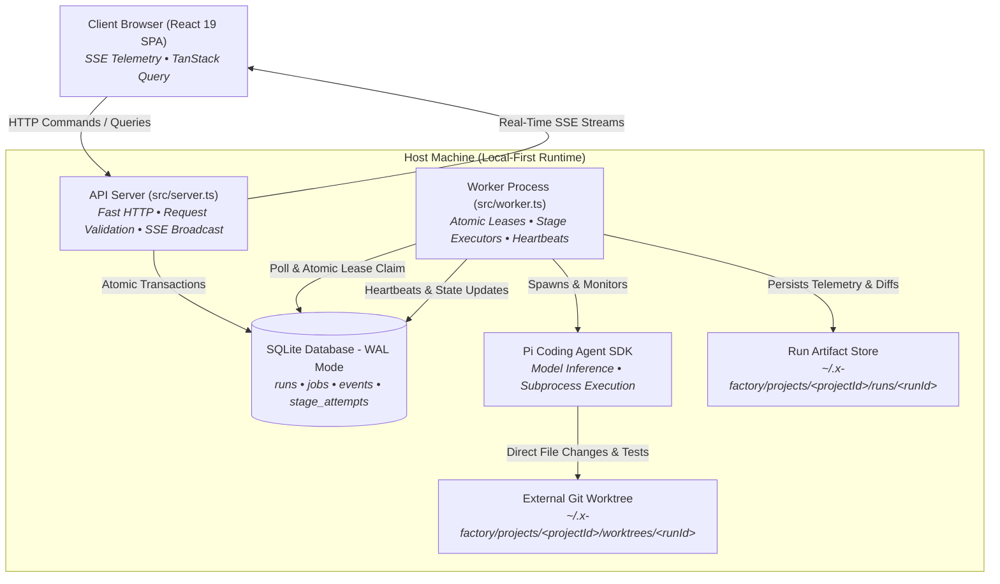

# X-Factory

Deterministic autonomous software engineering workbench: **ticket → understand → implement → verify → review → deliver**.

X-Factory is an autonomous, local-first software engineering factory powered by Bun, TypeScript, SQLite WAL, and [Pi](https://pi.dev) coding agents. It takes an approved issue ticket, acceptance criteria, and technical plan, executes code changes in isolated external Git worktrees, enforces deterministic verification with bounded self-repair, conducts an independent read-only review, and presents a human checkpoint before pull request creation.

---

## Why X-Factory?

Coding agents generate code quickly, but unconstrained agents introduce subtle bugs, broken tests, style violations, and repository pollution. 

X-Factory establishes a deterministic, fault-tolerant runtime around the agent:
- **Zero Hallucinated Progress**: Changes must pass your real compiler, linter, and test suite.
- **Isolated Execution**: Agent modifications happen exclusively in dedicated external Git worktrees (`~/.x-factory/projects/<id>/worktrees/`), never on your active working branch.
- **Bounded Self-Repair**: When tests fail, X-Factory captures compiler and test outputs, feeds diagnostics back to the agent, and attempts automated repair (3 attempts in total; the first attempt counts).
- **Independent Adversarial Review**: A separate, read-only agent evaluates the diff against the original ticket acceptance criteria before human handoff.
- **Crash-Resilient Multi-Process Architecture**: Web serving and background execution run in decoupled processes coordinated through durable SQLite leases.

---

## Architecture & Process Topology

X-Factory separates HTTP request handling, persistent storage, and autonomous agent orchestration across discrete process boundaries on a single host:



### Core Invariants

1. **API Invariant**: `src/server.ts` handles HTTP routing, payload validation, and SQLite persistence. It **never** executes workflow stages, spawns agents, or runs git commands. Each command writes its intent to SQLite and returns at once.
2. **Worker Invariant**: `src/worker.ts` is an independent background Bun process. It polls SQLite, atomically claims jobs with a lease, renews the lease by heartbeat, drives Pi agent sessions, and records execution telemetry. The lease and heartbeat timings have one owner, `DEFAULT_LEASE_POLICY` in `src/lease.ts`, and are explained in [process boundaries and topology](./docs/explanation/process-boundaries-and-topology.md).
3. **Database Invariant**: SQLite operating in Write-Ahead Logging (`PRAGMA journal_mode = WAL;`) is the single source of truth for runtime state. Mutations enforce optimistic concurrency control via a monotonic `revision` counter.
4. **Filesystem Invariant**: Large blobs, logs, and Git worktrees live on disk under `~/.x-factory/`. SQLite stores metadata and path references, never raw file blobs.

---

## Workflow Lifecycle

Every task advances through a strictly governed finite state machine:

```mermaid
flowchart LR
    Ticket([Issue tracker ticket<br/><i>GitHub / Jira / Azure</i>]) --> Prepare

    subgraph Pipeline["Canonical workflow engine"]
        Prepare["1. Prepare<br/><i>Clone, branch, worktree</i>"]
        Understand["2. Understand<br/><i>Ticket and code context</i>"]
        Chk1{{"Checkpoint<br/><i>Approve Understanding</i>"}}
        Plan["3. Plan<br/><i>Task list</i>"]
        Chk2{{"Checkpoint<br/><i>Approve Plan</i>"}}
        Execute["4. Execute<br/><i>Ralph loop, then the Reviewer model</i>"]
        Review{{"5. Review<br/><i>Human: Approve Changes</i>"}}
        Ready["6. Deliver<br/><i>Ready for a pull request</i>"]
    end

    Prepare --> Understand --> Chk1
    Chk1 -->|"Approve Understanding"| Plan
    Chk1 -->|"Request Changes"| Understand
    Plan --> Chk2
    Chk2 -->|"Approve Plan"| Execute
    Chk2 -->|"Request Changes"| Understand
    Execute --> Review
    Review -->|"Approve Changes"| Ready
    Review -->|"Request Changes"| Plan

    Ready -->|"Create Pull Request"| PR([Pull request created<br/><i>Waiting for merge</i>])
    PR -->|"Merge detection"| Merged([Merged])

    classDef stage fill:#f8fafc,stroke:#334155,stroke-width:1.5px;
    classDef checkpoint fill:#eff6ff,stroke:#2563eb,stroke-width:2px;
    classDef terminal fill:#ecfdf5,stroke:#059669,stroke-width:2px;
    class Prepare,Understand,Plan,Execute,Ready stage;
    class Chk1,Chk2,Review checkpoint;
    class Ticket,PR,Merged terminal;
```



1. **Prepare**: Allocates a unique run ID, clones the target repository when its local checkout is missing, creates the branch `factory/<ticket>-<slug>`, and provisions an isolated Git worktree outside that repository.
2. **Understand**: Synthesizes codebase symbols, documentation, and the ticket into an `ImplementationContext` artifact. Pauses at the human checkpoint `awaiting_understanding_approval` (**Approve Understanding**).
3. **Plan**: Synthesizes a structured markdown task list and constraints from the acceptance criteria. Pauses at the human checkpoint `awaiting_plan_approval` (**Approve Plan**).
4. **Execute**: Drives the autonomous Ralph loop in the worktree and streams iteration events. When verification passes, the Reviewer model runs inside this stage: it reads the diff against the acceptance criteria and records a read-only verdict. The run then pauses at `awaiting_review`.
5. **Review**: The human checkpoint at `awaiting_review`. The run page shows the diff, the artifacts, and the execution evidence. **Approve Changes** moves the run to `ready_for_pr`. **Request Changes** sends the run back to `planning` with your feedback, so the plan is revised before the code runs again.
6. **Deliver**: The run waits in `ready_for_pr` for your **Create Pull Request**. The worker then publishes the branch, creates the pull request on GitHub or Azure DevOps, and the run becomes `pr_created`.
7. **Merge detection**: While a run is `pr_created`, the worker checks its pull request every 5 minutes. When a pull request is merged or closed, the worker records a `pr_merged` or `pr_closed` event and stops checking that run. Checking also stops 30 days after the run was created.

Jira is a ticket tracker only, with no pull request delivery, so a Jira ticket's run ends at `ready_for_pr`.

---

## Quickstart

### Prerequisites

- **Bun** ≥ 1.4.0 ([install](https://bun.sh))
- **Git CLI**, with credentials that can read your target repositories
- **`sbx`**, the sandbox the coding stage runs the agent in. Install it, or read [How to Check the Sandbox](./docs/how-to/install-and-check-sbx.md). The coding stage fails closed without it unless you explicitly allow running without a sandbox.

### Setup

```bash
git clone https://github.com/tkz96/x-factory.git
cd x-factory
bun install
bun run dev
```

`bun run dev` starts three processes together: the API on port 3777, the worker, and the Vite frontend on port 5173.

Open **http://localhost:5173** in your browser.

X-Factory needs no API key in the environment. You add model connections in the app.

### First launch

The **Welcome** checklist shows what a first run needs. A step gets its tick only when the app can see that it is done:

1. **Add Project** — add your first repository.
2. **Connect a Model** — add a connection in **Settings › Models** (Gemini, Anthropic, or an OpenAI-compatible endpoint), pass **Check Connection**, then pick a model for each of the two roles:
   - **Builder** — writes the understanding, the plan, and the code.
   - **Reviewer** — reviews the diff against the acceptance criteria.
3. **Start Run** — open **Tickets**, pick a ticket, and use **Start Run** beside the Tickets heading.

Choose **I'll set up later** to skip the checklist.

### Add a project

Open **Projects** and use **Add Project** beside the heading, or start from the Welcome step. The assistant has five steps: paste a **Repository** URL, **Connect** a provider, choose the **Repositories**, run the **Inspection**, then **Review**. Submit with **Create Project**.

A run clones the repository on its first **Prepare** stage when no local checkout exists yet.

> **Production Mode**: To run without Vite HMR on a single port:
> ```bash
> bun run build
> bun run start:production  # Serves on http://localhost:3777
> bun run worker            # In a second terminal
> ```

---

## Configuration

X-Factory runs with no configuration at all. Every environment variable is optional, and each has a working default. Copy [`.env.example`](./.env.example) to `.env` to set any of them; Bun loads `.env` automatically. Every path these variables build comes from `src/paths.ts`.

| Variable | Default | What it does |
|---|---|---|
| `X_FACTORY_DATA_DIR` | `~/.x-factory` | Root of all on-disk runtime state: the database, settings, model connections, worktrees, artifacts, and backups. |
| `X_FACTORY_DB_PATH` | `<data dir>/x-factory.db` | The SQLite database file. |
| `X_FACTORY_CONFIG_PATH` | `./config/projects.json` | The projects configuration file. It is an authored repository input, so it is not moved under the data dir. |
| `BACKUP_DIR` | `<data dir>/backups` | Where `scripts/backup.ts` writes its snapshots. |
| `X_FACTORY_HOST` | `127.0.0.1` | The interface the API listens on. Change it only on a trusted network. |
| `PORT` | `3777` | The port the API listens on. |
| `NODE_ENV` | unset | Set to `production` by `bun run start:production`. Do not set it by hand. |
| `X_FACTORY_ALLOW_UNSANDBOXED` | unset | `1` lets the coding stage run without `sbx`. Prefer the Settings switch. See [How to Check the Sandbox](./docs/how-to/install-and-check-sbx.md). |
| `GEMINI_API_KEY`, `ANTHROPIC_API_KEY`, `OPENAI_API_KEY` | unset | Overrides the stored key of the matching connection in **Settings › Models**. |
| `LLM_API_KEY`, `LLM_PROVIDER` | unset | Legacy import, first launch only: `LLM_API_KEY` becomes a model connection once, and `LLM_PROVIDER` names its provider when the key's prefix does not. |

---

## Tickets and the Work Queue

X-Factory does not poll trackers in the background. When you open **Tickets**, the API process fetches the active tickets of every configured tracker on demand. To make a ticket available for a run, apply the keyword `agentic-workflow`:

| Tracker | Native Taxonomy | How to Apply | Filter Query |
| :--- | :--- | :--- | :--- |
| **Azure DevOps** | **Tag** (`System.Tags`) | Click **`+ Add Tag`** below title → `agentic-workflow` | `[System.Tags] CONTAINS 'agentic-workflow'` |
| **GitHub Issues** | **Label** | Select **Labels** in sidebar → `agentic-workflow` | `is:open label:agentic-workflow` |
| **Jira Software** | **Label** | Add `agentic-workflow` to **Labels** field | `labels = 'agentic-workflow' AND statusCategory != Done` |

> [!IMPORTANT]
> **Strict Enforcement for Azure DevOps:** X-Factory requires the native work item **Tag** (`+ Add Tag`). Custom form fields named `Label` are ignored to guarantee board and query compatibility.

Runs start only by hand: pick a ticket and use **Start Run**. X-Factory never starts a run on its own.

---

## Project Structure

```text
x-factory/
├── src/
│   ├── server.ts             # Bun HTTP server: routing, validation, SQLite writes, SSE
│   ├── worker.ts             # Job loop: leases, heartbeats, stage executors, PR polling
│   ├── shared/               # Domain types and the run-status policy (FSM, sets, actions, labels)
│   ├── db/                   # SQLite connection, repositories, and migrations 001–013
│   ├── executors/            # Stage executors (prepare, understand, plan, execute, review, deliver)
│   ├── agents/               # The Pi coding-agent session
│   ├── http/                 # Controllers, Zod input schemas, static asset serving
│   ├── providers/            # Provider registry and modules (GitHub, Azure DevOps, Jira)
│   ├── services/             # Project creation, connection writes, creation claims
│   ├── inspection/           # Repository inspection and readiness
│   ├── diagnostics/          # Request correlation, the sandbox check, telemetry
│   ├── model-*.ts            # Model connections, catalog, roles, budgets, and gateway
│   └── frontend/             # React 19 SPA: React Aria blocks, TanStack Query, Vite
├── docs/                     # Diátaxis documentation suite
│   ├── tutorials/            # Learning-oriented lessons for beginners
│   ├── how-to/               # Goal-oriented operational guides
│   ├── reference/            # Factual schemas, transition matrices, and API contracts
│   ├── explanation/          # Architectural rationale and design trade-offs
│   ├── agents/               # Guides for coding agents (see AGENTS.md)
│   └── research/             # Archived research, kept for history
├── config/                   # Authored project configuration (projects.json)
└── test/                     # 276 test files; bunfig.toml sets an 80% line-coverage floor
```

---

## Developer Commands

Run every gate with one command before you call a change done:

```bash
bun run check:all                   # Run every quality gate; the one command to run before "done"
```

The individual commands:

```bash
bun run dev                         # Start the API (3777) + worker + Vite (5173) together
bun run dev:api                     # Start the API alone in watch mode
bun run dev:frontend                # Start the Vite frontend alone (port 5173, HMR)
bun run worker                      # Start the independent background worker
bun run start:production            # Serve the pre-built assets from the API process (port 3777)
bun test                            # Run the whole test suite
bun run test:coverage               # Run the suite and enforce the coverage floor
bun run test:integration            # Run server lifecycle, API contracts, and SSE tests
bun run test:frontend-smoke         # Run UI shell, navigation, and modal structural smoke tests
bun run check:agent-docs            # Check AGENTS.md and docs/agents/ links and paths
bun run docs:schema                 # Regenerate the structural section of database-schema.md
bun run screenshots <screen|all>    # Capture before/after evidence (see docs/agents/screenshots.md)
bun run build                       # Bundle and assemble the production assets into dist/public
bun run typecheck                   # Verify backend TypeScript types (tsc --noEmit)
bun run typecheck:frontend          # Verify browser TypeScript types (tsc frontend config)
bun run lint                        # Check formatting and lint rules (biome check .)
bun run lint:fix                    # Autofix formatting and safe lint rules
bun run check:knip                  # Detect unused exports, files, and dependencies
bun run check:cycles                # Verify zero circular import dependencies (dpdm)
bun run check:fallow                # Verify architectural boundaries and maintainability
bun scripts/backup.ts               # Write an atomic VACUUM snapshot and artifact archive
```

The 80% line-coverage floor is in `bunfig.toml`. `bunfig.selective.toml` turns coverage off for `test:integration` and `test:frontend-smoke`, so a single test file cannot fail the whole-codebase floor. How the gates and lint baselines work is in [`docs/agents/ci-checks.md`](./docs/agents/ci-checks.md).

---

## Frontend Development & Design System

The X-Factory workbench frontend is a local-first Single Page Application designed according to the **Apple Human Interface Guidelines (HIG)**:

- **Stack**: React 19, Vite 8, React Router 7, React Aria Components, TanStack Query 5, and Motion 14.
- **Real-Time Telemetry**: Server-Sent Events (SSE) update the TanStack Query cache directly, without refetching a page or causing a flicker.
- **Design Foundations**: Layout, typography, spacing, colors, radius, and motion follow [`DESIGN.md`](./DESIGN.md) through semantic CSS variables.
- **Appearance**: three themes (**Default**, **Graphite**, **Sandstone**). Each has a light and a dark appearance, and each appearance has a standard and an increased-contrast set. Forced-colours mode is handled separately.
- **Blocks, not bespoke controls**: every control comes from the one vocabulary in `src/frontend/components/ui/` — button, icon button, text field, select, segmented control, switch, badge, list row, list group, and spinner. The blocks are built on React Aria and styled with tokens, and a screen composes them without naming their classes.
- **Radius ladder**: one ladder of six rungs (`--radius-xs` 4, `--radius-sm` 8, `--radius-md` 12, `--radius-card` 16, `--radius-lg` 20, `--radius-full`). A control's radius comes from its size, and an inner shape's radius is the outer radius minus the inset between them.
- **Grouped lists**: Settings panes, the Welcome checklist, the Runs list, the Projects list, and the Connections registry share one `ListGroup` shape.
- **Page actions**: a screen's one action (**Start Run**, **Add Project**) sits in the page heading, not in the toolbar. The toolbar carries the project picker, the section switch, search, the notification bell, and the gear.

### Modular CSS Architecture

To prevent style drift and bloated component files, frontend styling is structured into discrete layers under `src/frontend/styles/`:

```text
src/frontend/
├── styles/
│   ├── index.css             # Entrypoint imported once in main.tsx; sets the import order
│   ├── tokens.css            # Spacing grid, type scale, radius ladder, motion, and theme colors
│   ├── base.css              # HTML resets, font faces, and the reduced-motion rules
│   ├── shared/               # Reusable UI component patterns
│   │   ├── buttons.css       # Button and icon-button blocks
│   │   ├── controls.css      # Fields, selects, segmented controls, and switches
│   │   ├── badges.css        # State pills and workflow stage badges
│   │   ├── forms.css         # Form layout, hints, and focus rings
│   │   ├── cards.css         # Card materials, borders, and hover elevations
│   │   ├── scrollbar.css     # Consistent slim scrollbars
│   │   └── icons.css         # Optical sizing and SVG sprite alignment
│   ├── utilities.css         # Spacing, typography, color, and layout modifiers
│   └── forced-colors.css     # System colour keywords under forced-colours mode (imported last)
├── components/ui/            # The control vocabulary (React Aria blocks)
├── components/               # Components with co-located *.css files
└── views/                    # Top-level route views with co-located *.css files
```

### Developer Guidelines & Quality Invariants

When developing or modifying UI components:

1. **Zero Inline Styles (`style={{...}}`)**:
   Inline style declarations in `.tsx` files are strictly prohibited. Always use semantic CSS tokens, utility classes, or a co-located component stylesheet. The one exception is passing a CSS custom property.
2. **Co-located Component Styles**:
   Any view or component requiring bespoke styling must maintain an adjacent `.css` file (e.g. `QueueView.css` alongside `QueueView.tsx`) and import it explicitly (`import "./QueueView.css"`).
3. **No Hardcoded Values**:
   Never hardcode hex colors (`#fff`), arbitrary pixel spacing (`margin: 17px`), or arbitrary font sizes. Use semantic tokens defined in `tokens.css` (`var(--text)`, `var(--space-4)`, `var(--text-headline)`).
4. **Compose the Blocks**:
   Build controls from `src/frontend/components/ui/` instead of hand-rolling a button, field, switch, or badge.
5. **CI Enforcement**:
   The frontend design system is guarded by automated anti-drift tests:
   ```bash
   bun run typecheck:frontend     # TypeScript validation for browser bundle
   bun run test:frontend-smoke    # Validates zero inline styles, CSS layering, and DOM structure
   ```

---

## Documentation

Full project documentation is structured using the [Diátaxis Framework](https://diataxis.fr) and written in [ASD-STE100 Simplified Technical English](./docs/README.md):

| Quadrant | Purpose | Key Documents |
|---|---|---|
| **[Tutorials](./docs/tutorials/first-agent-run.md)** | Learning-oriented guide for newcomers | [Run Your First Agent Workflow](./docs/tutorials/first-agent-run.md) |
| **[How-To Guides](./docs/how-to/verify-worker-and-pi-session.md)** | Step-by-step problem-solving recipes | [Verify Worker Leases & Sessions](./docs/how-to/verify-worker-and-pi-session.md)<br/>[Database Backup & Disaster Recovery](./docs/how-to/backup-and-restore-database.md)<br/>[Check the Sandbox (sbx)](./docs/how-to/install-and-check-sbx.md) |
| **[Reference](./docs/reference/database-schema.md)** | Factual technical specifications | [Database Schema & Entities](./docs/reference/database-schema.md)<br/>[State Machine Transition Matrix](./docs/reference/state-machine-matrix.md)<br/>[Production Readiness Checklist](./docs/reference/production-readiness-checklist.md) |
| **[Explanation](./docs/explanation/process-boundaries-and-topology.md)** | Architectural understanding & "why" | [Process Boundaries & System Topology](./docs/explanation/process-boundaries-and-topology.md)<br/>[UI State & Event Streaming](./docs/explanation/ui-state-and-event-streaming.md) |

For the central documentation index, visit [`docs/README.md`](./docs/README.md).

---

## License

MIT
